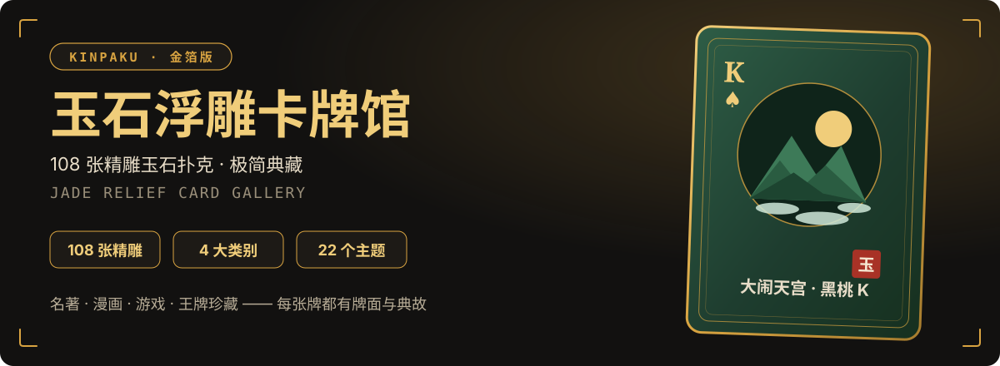
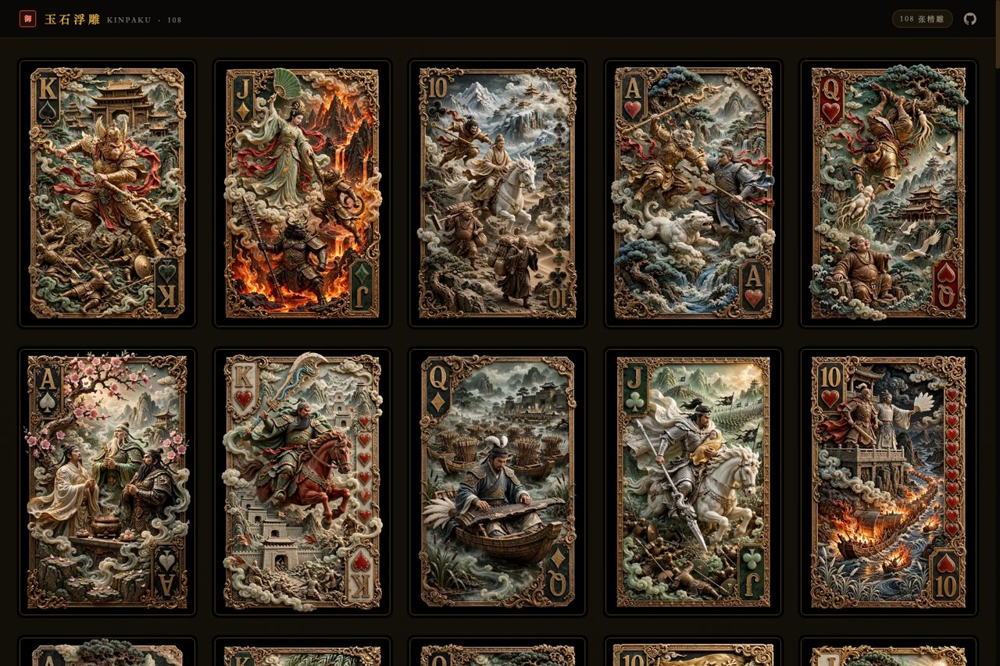
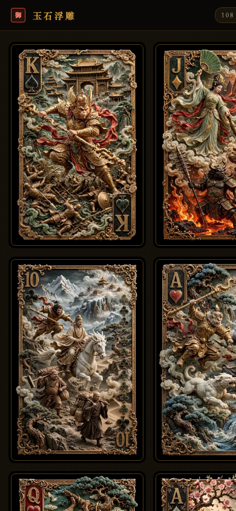

<p align="right"><a href="README.md">中文</a></p>

<p align="center">
  
</p>

<p align="center">
  <a href="https://xiaosang.cc/jade-cards-lab/">▶ Visit the Gallery</a>
  ·
  <a href="https://github.com/holynova/jade-cards-lab">GitHub Repository</a>
</p>

Jade Relief Card Gallery (Kinpaku Edition) is a minimalist gallery of 108 hand-carved jade playing cards — each one a jade relief artwork: Journey to the West, Three Kingdoms, Water Margin, Dream of the Red Chamber, Dragon Ball, One Piece, Genshin Impact, Pokémon, and more, arranged as a full deck of cards. Click any card for a full-screen view; on desktop, hovering tilts the card in 3D with a golden sheen.

## Screenshots

<p align="center">
  
  
</p>

## Collection

108 cards, 4 categories, 22 themes, 5 cards per theme (plus 3 Ace Collection cards):

| Category | Cards | Themes |
| :--- | :---: | :--- |
| 名著 (Classics) | 35 | 西游记 (Journey to the West), 三国演义 (Romance of the Three Kingdoms), 水浒传 (Water Margin), 红楼梦 (Dream of the Red Chamber), 聊斋志异 (Strange Tales from a Chinese Studio), 封神演义 (Investiture of the Gods), 史记 (Records of the Grand Historian) |
| 漫画 (Comics) | 35 | 龙珠 (Dragon Ball), 海贼王 (One Piece), 火影忍者 (Naruto), 鬼灭之刃 (Demon Slayer), 哆啦A梦 (Doraemon), 名侦探柯南 (Detective Conan), 灌篮高手 (Slam Dunk) |
| 游戏 (Games) | 35 | 黑神话：悟空 (Black Myth: Wukong), 艾尔登法环 (Elden Ring), 塞尔达传说 (The Legend of Zelda), 原神 (Genshin Impact), 宝可梦 (Pokémon), 王者荣耀 (Honor of Kings), 超级马里奥 (Super Mario) |
| 特别 (Special) | 3 | 王牌珍藏 (Ace Collection: 九龙玉玺 Nine-Dragon Jade Seal, 和氏璧 He's Jade, 广告牌 Billboard) |

Every card has a poker rank (e.g. 「大闹天宫 · 黑桃 K」 — Havoc in Heaven · King of Spades) and a matching story; the card back is a unified jade relief pattern.

## Experience

- **3D tilt**: on desktop, hovering a card tilts it in the direction of the mouse (rotateX / rotateY) with a golden sheen.
- **Full-screen viewing**: click any card to open a lightbox, with prev/next navigation and keyboard support.
- **Category filters**: filter by 名著 (Classics) / 漫画 (Comics) / 游戏 (Games) / 特别 (Special), with card counts shown at the top.
- **Loading optimization**: the grid uses Retina WebP thumbnails (`assets/thumbs/`); full images load only when opened. Zero CLS, async decoding.

## Run Locally

Zero build, pure static page — just serve it:

```bash
python3 -m http.server 8000
# Open http://localhost:8000
```

The homepage redirects to `v-impeccable.html` (the Kinpaku edition main page).

## Tech

- Pure HTML + CSS + JS, zero dependencies, zero build; card data lives in `data.js` (the `CARDS` array, 108 entries).
- The 3D tilt uses CSS `perspective` with angles computed from JS `mousemove`; the lightbox supports keyboard navigation and focus management.
- Images come in two layers: full-size images in `img/` and thumbnails in `assets/thumbs/`, both WebP.

```
index.html              Entry (redirects to v-impeccable.html)
v-impeccable.html       Kinpaku edition main page (gallery + lightbox + 3D tilt)
data.js                 Data for 108 cards: filename / name / rank / theme / category
img/                    108 full-size WebP images + card back
assets/thumbs/          108 Retina thumbnail WebPs
assets/screenshot.png   Desktop screenshot (old)
```

## Note

The card artwork is AI-generated in a jade relief style; characters and stories are drawn from classic works and pop culture, and their rights belong to their respective owners.
