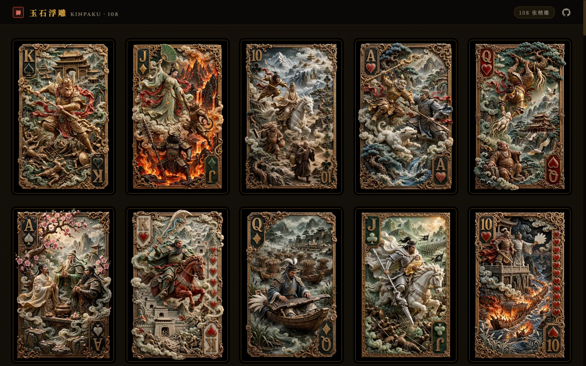

# Jade Cards Lab / 玉石卡牌实验室 · 金箔典藏

中文：玉石浮雕卡牌馆极简典藏版：收录四大主题 108 张精雕玉石扑克牌，极简正面纯净展陈，支持 PC 端 3D 卡牌倾角与鎏金光影交互、点击全屏大图品鉴，并针对图片加载与体积进行分层优化（Retina WebP 缩略图、零 CLS、异步平滑解码）。

English: Minimalist Edition of the Jade Relief Playing Card Gallery: featuring 108 cards across four themes with pure front-face presentation, PC 3D tilt and specular sheen interaction, full-screen lightbox inspection, and layered image loading optimization (Retina WebP thumbnails, zero CLS, async decoding).



## 在线体验 / Live Demo

- [Cloudflare Demo](https://xiaosang.cc/jade-cards-lab/)
- [GitHub Repo](https://github.com/holynova/jade-cards-lab)


## 本地运行 / Run locally

```bash
python3 -m http.server 8000
```

## 发布 / Deploy

```bash
npx wrangler deploy --config wrangler.jsonc
```

Cloudflare Workers · Domain: `xiaosang.cc` · Route: `/jade-cards-lab/`

源码与部署配置使用同一个主分支；在本地手动发布，不创建 Cloudflare 专用分支或 GitHub Action。
