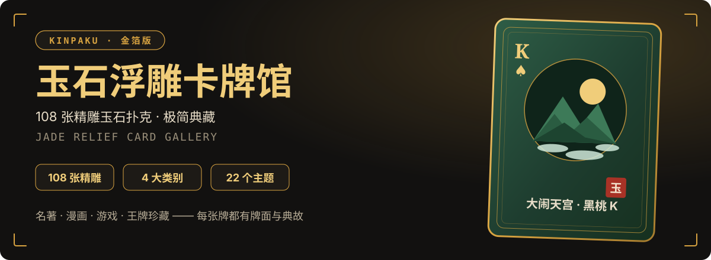
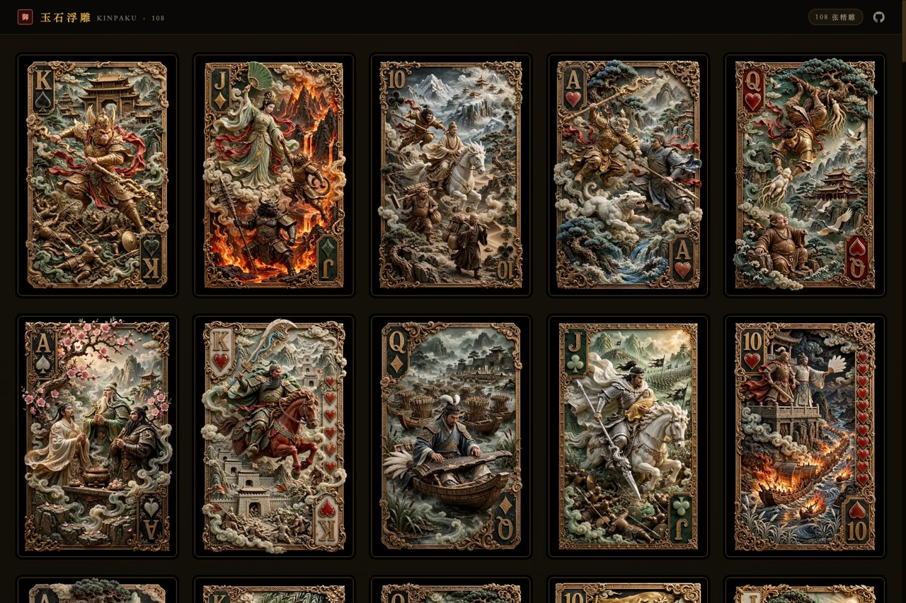
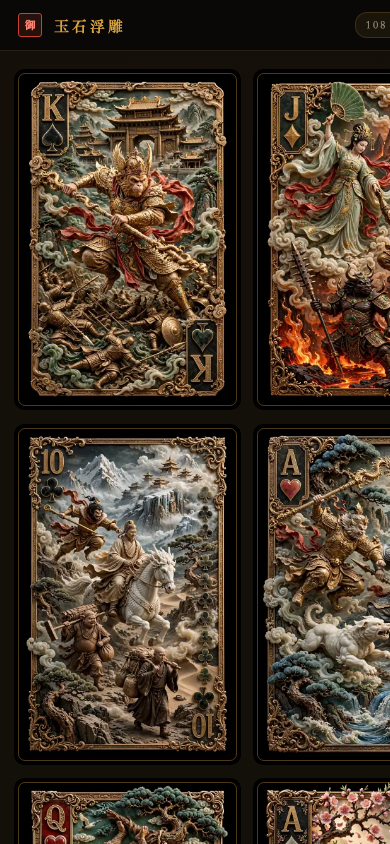

<p align="center">
  
</p>

<p align="center">
  <a href="https://xiaosang.cc/jade-cards-lab/">▶ 在线逛馆 Visit the Gallery</a>
  ·
  <a href="https://github.com/holynova/jade-cards-lab">GitHub 仓库</a>
</p>

玉石浮雕卡牌馆 · 金箔版是一座极简典藏画廊：108 张精雕玉石扑克牌，每张都是一幅玉石浮雕——西游、三国、水浒、红楼、龙珠、海贼、原神、宝可梦……按扑克牌面排布，点开可全屏品鉴。桌面端鼠标悬停时卡牌会 3D 倾斜并泛起鎏金光影。

Jade Relief Card Gallery (Kinpaku Edition) is a minimalist gallery of 108 hand-carved jade playing cards — each one a jade relief artwork: Journey to the West, Three Kingdoms, Dragon Ball, One Piece, Genshin Impact, Pokémon, and more, arranged as a full deck of cards. Click any card for a full-screen view; on desktop, hovering tilts the card in 3D with a golden sheen.

## 截图 / Screenshots

<p align="center">
  
  
</p>

## 收录 / Collection

108 张卡，4 大类别，22 个主题，每个主题 5 张（王牌珍藏 3 张）：

| 类别 | 张数 | 主题 |
| :--- | :---: | :--- |
| 名著 | 35 | 西游记、三国演义、水浒传、红楼梦、聊斋志异、封神演义、史记 |
| 漫画 | 35 | 龙珠、海贼王、火影忍者、鬼灭之刃、哆啦A梦、名侦探柯南、灌篮高手 |
| 游戏 | 35 | 黑神话：悟空、艾尔登法环、塞尔达传说、原神、宝可梦、王者荣耀、超级马里奥 |
| 特别 | 3 | 王牌珍藏（九龙玉玺、和氏璧、广告牌） |

每张卡都有扑克牌面（如「大闹天宫 · 黑桃 K」）与对应典故；卡背是统一的玉石浮雕纹样。

## 体验 / Experience

- **3D 倾角**：桌面端鼠标划过卡牌，卡面随鼠标方向倾斜（rotateX / rotateY），并泛起鎏金高光。
- **全屏品鉴**：点击任意卡牌打开灯箱（lightbox），可前后翻张、键盘操作。
- **分类筛选**：按名著 / 漫画 / 游戏 / 特别筛选，顶部显示各类别张数。
- **加载优化**：列表用 Retina WebP 缩略图（`assets/thumbs/`），点开才加载全图；零布局偏移（CLS）、异步解码。

## 本地运行 / Run Locally

零构建，纯静态页面，直接起一个静态服务器：

```bash
python3 -m http.server 8000
# 打开 http://localhost:8000
```

首页会自动跳转到 `v-impeccable.html`（金箔版主页面）。

## 技术 / Tech

- 纯 HTML + CSS + JS，零依赖、零构建；卡牌数据在 `data.js`（`CARDS` 数组，108 条）。
- 3D 倾斜用 CSS `perspective` + JS `mousemove` 计算角度；灯箱支持键盘导航与焦点管理。
- 图片分两层：`img/` 全图 + `assets/thumbs/` 缩略图，均为 WebP。

```
index.html              入口（跳转到 v-impeccable.html）
v-impeccable.html       金箔版主页面（画廊 + 灯箱 + 3D 倾斜）
data.js                 108 张卡的数据：文件名 / 名称 / 牌面 / 主题 / 类别
img/                    108 张全图 WebP + 卡背
assets/thumbs/          108 张 Retina 缩略图 WebP
assets/screenshot.png   桌面端截图（旧）
```

## English

**Jade Relief Card Gallery · Kinpaku Edition** is a minimalist gallery of 108 jade-relief playing cards. Each card is a carved jade artwork depicting a classic story or character, laid out as a full deck.

- **108 cards, 4 categories, 22 themes**: Classics (35) — Journey to the West, Three Kingdoms, Water Margin, Dream of the Red Chamber, Strange Tales, Investiture of the Gods, Records of the Grand Historian; Comics (35) — Dragon Ball, One Piece, Naruto, Demon Slayer, Doraemon, Detective Conan, Slam Dunk; Games (35) — Black Myth: Wukong, Elden Ring, Zelda, Genshin Impact, Pokémon, Honor of Kings, Super Mario; plus 3 Special "Ace Collection" cards.
- **Every card has a rank** (e.g. Havoc in Heaven · King of Spades) and a matching story; the card back is a unified jade relief pattern.
- **Interactions**: 3D tilt with golden sheen on hover (desktop), full-screen lightbox with prev/next and keyboard navigation, category filters with counts.
- **Performance**: Retina WebP thumbnails in the grid, full images loaded on demand; zero CLS, async decoding.
- **Run it**: `python3 -m http.server 8000` — no build step, no dependencies. Data lives in `data.js`; images in `img/` (full) and `assets/thumbs/`.

## 许可 / License

仓库内暂无 LICENSE 文件；卡牌图案为 AI 生成的玉石浮雕风格艺术图，人物与故事取材自经典作品与流行文化，版权归各自权利人所有。
